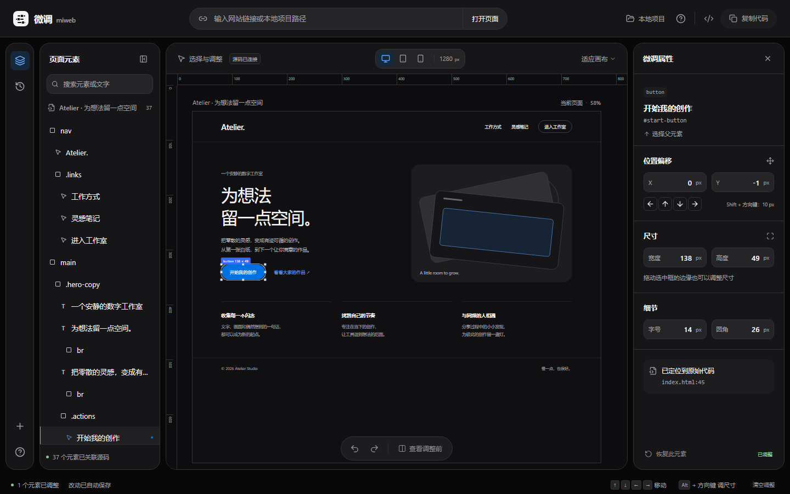

# Miweb 微调

**轻量的桌面网页布局微调工具。为 AI 生成的前端，补上最后一点调整。**

[Windows x64](https://github.com/NullResot/miweb/releases/latest/download/Miweb-Setup-x64.exe) · [macOS Apple 芯片](https://github.com/NullResot/miweb/releases/latest/download/Miweb-mac-arm64.dmg) · [macOS Intel](https://github.com/NullResot/miweb/releases/latest/download/Miweb-mac-x64.dmg) · [使用文档](https://nullresot.github.io/miweb/guide/overview.html) · [开发与构建](#开发与构建)

AI 生成的页面已经差不多了，但按钮还想往上一点，卡片还想宽一点。

Miweb 让你直接在页面上调整这些细节：输入网页链接，或导入本地项目，选中元素，用鼠标拖动、方向键微调，再复制代码带回项目。



*工作台截图，使用内置示例项目。*

## 核心功能

- **安装后直接使用** — 内置运行环境与 Chromium，无需安装 Node.js、配置服务或提供 AI API Key。
- **看着页面微调** — 拖动位置和尺寸，也可以输入精确的偏移、宽高、字号和圆角。
- **只修改需要修改的代码** — 导入支持的项目源码后，尽量将改动落在对应元素，保留无关代码、注释与格式。
- **网页链接也能用** — 支持公开网址和本地开发链接，导出 CSS 或 JavaScript 布局补丁。
- **随时撤销和对比** — 支持撤销、重做、恢复元素，以及调整前后比较。
- **方便带走结果** — 复制代码，或查看、下载修改后的源文件、最小差异和布局补丁。

适合微调 AI 生成的网页，也适合调整已有前端的布局细节。编辑过程不需要调用 AI 模型或提供 API Key。

## 怎么用

1. **打开页面**：粘贴网址、本地开发链接或项目路径，也可以选择项目文件夹。第一次使用可先点击“试用示例”。
2. **选中元素**：点击画布中的按钮、文字或容器，用鼠标和方向键调整。
3. **检查效果**：切换桌面、平板或手机预览，查看调整前后的变化。
4. **带走代码**：复制或下载结果，再应用到自己的项目。

**导入源码，导出局部源码修改；只提供网址，导出布局补丁。** Miweb 不会从构建后的网页还原原始 React/Vue 工程，也不会自动覆盖你的项目文件。

## 安装桌面版

| 系统 | 下载 | 安装方式 |
| --- | --- | --- |
| Windows 10 / 11 x64 | [Windows 安装包](https://github.com/NullResot/miweb/releases/latest/download/Miweb-Setup-x64.exe) | 双击安装，打开 Miweb |
| macOS 13 Ventura 或更高版本，Apple 芯片 | [Apple 芯片 DMG](https://github.com/NullResot/miweb/releases/latest/download/Miweb-mac-arm64.dmg) | 打开 DMG，将 Miweb 拖入“应用程序” |
| macOS 13 Ventura 或更高版本，Intel 处理器 | [Intel DMG](https://github.com/NullResot/miweb/releases/latest/download/Miweb-mac-x64.dmg) | 打开 DMG，将 Miweb 拖入“应用程序” |

不确定 Mac 类型时，打开苹果菜单的“关于本机”：显示“芯片”的选择 Apple 芯片版，显示 Intel“处理器”的选择 Intel 版。macOS 安装后推出磁盘映像，再从“应用程序”打开 Miweb。

- 点击“选择项目文件夹”，使用系统目录选择窗口接入本地项目。
- 粘贴公开网址或本地开发链接，导入当前页面。
- 暂时没有项目，可以先点击“试用示例”。

安装包包含编辑器和页面渲染器，不需要用户另外安装运行依赖。编辑服务仅监听本机，应用退出时关闭。Windows 安装包未使用商业代码签名证书；macOS 应用仅使用临时签名（ad-hoc），没有 Developer ID 签名或 Apple 公证，系统可能拦截首次启动。请先确认下载来源并核对对应 [Release](https://github.com/NullResot/miweb/releases) 的校验值，再按 [安装说明](https://nullresot.github.io/miweb/guide/install.html#macos-首次打开被拦截) 处理。Linux 安装包尚未发布。

完整步骤见 [安装说明](https://nullresot.github.io/miweb/guide/install.html) 和 [第一次微调](https://nullresot.github.io/miweb/guide/getting-started.html)。

## 支持哪些输入

| 输入 | 预览方式 | 导出结果 |
| --- | --- | --- |
| `https://example.com` | 隔离浏览器加载并渲染当前地址 | 使用原页面选择器的布局补丁 |
| `http://localhost:5173` | 加载已经运行的本地开发页面 | 布局补丁 |
| `D:\projects\my-site` | 只读加载项目，建立源码位置映射 | 修改后的源文件、最小 diff、CSS 补丁 |
| 选择项目文件夹 | 临时导入并预览项目 | 修改后的源文件、最小 diff、CSS 补丁 |

文件夹/目录模式支持普通 HTML，以及具有 `index.html` 入口的 Vite React/JSX/TSX、Vue SFC 项目。默认识别 React、Vue 和 `@/` 别名。**不会执行项目配置文件、npm 脚本，也不会直接修改原项目。** 含自定义插件、其他路径别名、特殊构建或 Next.js 的项目，请先启动它自己的开发服务，再输入 localhost 链接。

其他包依赖需要已安装在被连接项目中。上传文件夹会排除 `node_modules`、`.git`、常见构建产物和 `.env`；因此依赖其他包的上传项目可能无法预览。此时使用本地目录模式或已启动的开发链接。

## 操作与代码导出

- 点击元素，或者通过元素列表和搜索选择；可选择父元素。
- 拖动元素改变位置，拖动八个控制点改变宽高。
- 方向键移动 1px，Shift + 方向键移动 10px，Alt + 方向键调整宽高。
- 输入 X/Y 偏移、宽高、字号和圆角。
- 撤销/重做、恢复单个元素、清空调整、查看调整前后的变化。
- 桌面、平板、手机宽度预览与画布缩放。
- 一键复制，或预览、复制和下载完整修改后源码 / unified diff / CSS。

**源码模式**以原文件的字符串位置做最小修改：HTML 的 `style` 属性、React 的 `style` 对象、Vue 的静态/绑定样式。保留其他代码、注释、换行和格式，不通过整个文件重新序列化。多个组件实例映射到同一个源元素时会同步调整。

**链接模式**无法反推出构建前的原始 React/Vue 代码，因此导出带有原页面选择器的 CSS 补丁。将补丁放在原样式的末尾。对于不能可靠确定有效样式的属性展开节点，源码模式也会退回 CSS 补丁，并在交付窗口说明。

原页面使用 `!important` 时会额外检查样式优先级。HTML/Vue 源码保留重要声明；React 在内联样式无法可靠覆盖时改用布局补丁。CSS 补丁会提高选择器优先级；若需要覆盖内联重要样式、级联层中的重要声明或过高的选择器优先级，则生成 JavaScript 补丁并明确提示它的使用位置。

Windows 剪贴板可能把换行转换为 CRLF。下载的源码文件和生成的 diff 保留原文件换行，源码导出不会改写未调整的部分。

位移使用独立的 CSS `translate`，保留原有的 `transform`。宽高以 border-box 像素计算。修改默认作用于所有屏幕宽度；不同宽度预览用于检查影响。Flex/Grid、min/max-width、父级裁剪、内联元素等布局约束仍然有效，不会为绕开约束自动重写页面结构。

## 使用限制

- 编辑当前地址的渲染快照，暂停原页面脚本与链接导航；不会操作子页面。
- 不复制用户浏览器的登录态。需要登录、反自动化、Canvas、Shadow DOM、跨域内嵌内容或依赖实时交互的页面，可能无法完整捕获。
- 页面渲染失败时会显示具体错误，保留已有画布和改动。
- 会话保存在服务进程内，默认空闲有效期 120 分钟。改动保存在当前浏览器；服务重启或会话过期后需要重新导入页面。完成调整后应复制或下载代码。
- 原文件由用户在自己的项目中替换或通过 diff 应用。不会自动保存到原项目或部署目标网站。

## 兼容的服务部署

这是 **React 前端 + Node.js/Express 服务 + Chromium 渲染器** 的完整网站，需要能够运行 Node.js 和 Chromium 的服务器；单纯静态托管不能完成网页捕获。使用 HTTPS 反向代理，服务端不需要接入 AI 模型或付费 API。

```powershell
$env:HOST = '0.0.0.0'
$env:LOCAL_ACCESS = '0'
$env:MIWEB_ACCESS_KEY = '替换成随机生成的访问密钥'
$env:PUBLIC_ORIGIN = 'https://tune.example.com'
npm run server:start
```

公开监听必须配置访问密钥，界面会要求输入。公开模式禁用本地目录、localhost 和内网访问，仍支持用户选择文件夹上传。公开网站不会自动读取访问者电脑上的目录路径。这里的服务适用于受控用户或团队使用，尚未包含独立用户账号、团队权限、付费和跨服务持久化。

通过 HTTPS 反向代理访问时，需要把 `PUBLIC_ORIGIN` 设置为网站实际的域名；它用于资源链接和请求来源检查。代理应将网站根路径转发到 Node 服务，保留 Host，并为页面加载提供至少 60 秒的接口超时。

迁移到 Ubuntu 时使用随项目提供的 Docker Compose 与 Nginx 配置。完整的打包迁移、HTTPS、上线验收、更新与回滚步骤见 **[Ubuntu 部署文档](docs/ubuntu.md)**。

先将 `deploy/production.env.example` 复制为 `deploy/production.env`，填写随机访问密钥和实际 HTTPS 域名，然后运行：

```sh
docker compose --env-file deploy/production.env up -d --build --wait --wait-timeout 180
curl --fail http://127.0.0.1:4173/api/health
```

Compose 仅将服务端口绑定到服务器的 `127.0.0.1`，公开访问由 HTTPS 反向代理提供。环境变量通过操作系统或容器注入，`.env.example` 仅作参考；服务不会自动读取 `.env`。

| 变量 | 默认值 | 用途 |
| --- | --- | --- |
| `PORT` | `4173` | 网站端口 |
| `HOST` | `127.0.0.1` | 监听地址 |
| `LOCAL_ACCESS` | 本地监听开启，其他关闭 | 允许 localhost 与本地项目目录 |
| `MIWEB_ACCESS_KEY` | 无 | 服务访问密钥，公开监听时必须设置 |
| `PUBLIC_ORIGIN` | 请求中的地址 | HTTPS 反向代理下的实际网站来源地址 |
| `SESSION_TTL_MINUTES` | `120` | 会话空闲过期时间，范围 5–1440 |
| `CHROMIUM_SANDBOX` | `0` | 设置 `1` 启用 Chromium sandbox，需宿主系统支持 |

抓取时验证每一个网络请求和重定向的 DNS/IP，并将验证地址固定到实际连接。阻止内网、云元数据和保留地址。本机代理使用 `198.18/15` 或 `2001:2::/48` 假地址时，经固定的 TLS 公网 DNS 解析器获取实际公网地址，再执行相同检查。限制抓取并发、请求数量、响应大小、会话数量和缓存字节数。

预览使用无 `allow-same-origin` 的 sandbox iframe 和只允许微调桥接脚本执行的 CSP；原网页脚本被移除。文件夹导入检查路径、大小和敏感文件。服务 API 可使用访问密钥；预览资源只通过随机会话/资源地址读取。

## 开发与构建

开发环境需要 Node.js 22.12+（推荐 24）和 Git。

```sh
git clone https://github.com/NullResot/miweb.git
cd miweb
npm ci
npm run browser:install
npm run desktop:dev
```

在 Windows x64 上构建一键安装包：

```sh
npm run desktop:dist:win
```

输出为 `release/Miweb-Setup-x64.exe`。`npm run desktop:pack` 仅生成未安装的 Windows 应用目录。

在 macOS 上构建当前机器架构的 DMG：

```sh
npm run desktop:dist:mac
```

Apple 芯片输出 `release/Miweb-mac-arm64.dmg`，Intel 输出 `release/Miweb-mac-x64.dmg`；`npm run desktop:pack:mac` 仅生成未安装的 `.app` 目录。请在对应架构的原生 macOS 环境打包，Chromium 与应用必须使用同一架构。安装包均包含 Chromium，打包过程可能下载运行环境。macOS 包默认采用临时签名，不执行 Apple 公证。

公开网站包含完整滚动演示首页与静态文档，开发和构建方式如下：

```sh
npm run dev
npm run docs:build
```

文档由 GitHub Actions 构建并发布到 GitHub Pages，源文件在 `docs/site`。工作台独立开发入口是 `npm run editor:dev`。详细说明见 [开发文档](docs/site/reference/developing.md)。

## 开发与测试

```powershell
npm test
npm run test:integration
npm run build
npm run test:e2e
npm run test:desktop
npm run docs:build
```

单元测试覆盖最小源码修改、动态样式、重复实例、源文件格式保留，以及网络访问边界。集成测试实际启动 Chromium 验证 HTML、React、Vue、JavaScript 内容、重定向、CSS 和项目隔离。E2E 启动独立的生产服务，执行真实鼠标、键盘、复制和下载流程。最终验收结果、容器测试与已知边界见 [QA.md](QA.md)。

### 项目结构

- `desktop/main.cjs`、`desktop/preload.cjs`：桌面窗口、本机服务与系统文件夹选择。
- `docs/site`：静态文档站。
- `.github/workflows`：文档部署与桌面发布。

- `src/App.tsx`：工作台、选择、属性、撤销、对比与导出。
- `src/Landing.tsx`、`src/dark-gallery.css`：首页与分章节入场动效。
- `src/ScrollShowcase.tsx`、`src/scroll-showcase.css`：原生滚动操作演示及减少动态效果支持。
- `src/editor-gallery.css`：真实工作台与弹窗的统一皮肤。
- `src/bridge.js`：隔离画布内的拖动、缩放和键盘控制。
- `server/capture.mjs`：真实页面渲染与安全快照。
- `server/project.mjs`：只读项目预览与临时构建缓存。
- `server/project-css.mjs`：有边界的样式依赖加载与导入条件处理。
- `server/source.mjs`：元素源码定位与最小修改。
- `server/network.mjs`：地址检查、DNS 固定与受限抓取。

实现参考：[Playwright 浏览器上下文](https://playwright.dev/docs/browser-contexts)、[Vite JavaScript API](https://vite.dev/guide/api-javascript)、[MDN iframe sandbox 与同源限制](https://developer.mozilla.org/en-US/docs/Web/HTML/Reference/Elements/iframe)。

## 设计与版本恢复

当前界面使用黑色主题与分章节滚动演示，动效基于 CSS 视图时间线与 IntersectionObserver，并支持减少动态效果。产品约定见 [PRODUCT.md](PRODUCT.md)，设计说明见 [DESIGN.md](DESIGN.md)。

改版前的完整前端与截图保存在 [原版备份](design-versions/2026-10-13-original/README.md)。需要回档时先保存当前 `src`，再用备份的 `src` 替换，并按需恢复 `index.html` 和 `examples/atelier/index.html`，然后执行 `npm run build`。后端无需回档。

上一轮白色科技风也单独保存在 [白色版备份](design-versions/2026-10-13-gallery-white/README.md)，可以恢复到该版本。黑色主题只影响编辑器自己的界面，导入网页不会被强制反色。

先前的 `miweb-ubuntu-20261013.tar.gz` 及 `miweb:verify` 镜像保留的是改版前版本；迁移新版请用当前源码重新打包、构建，避免误用旧前端。
